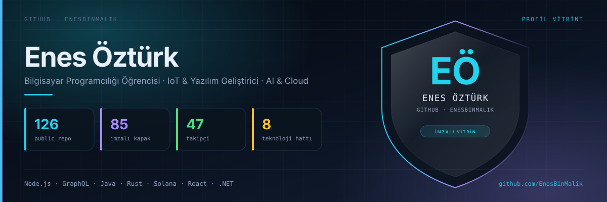
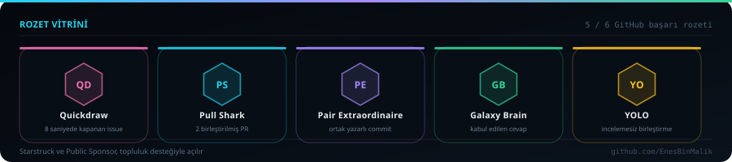
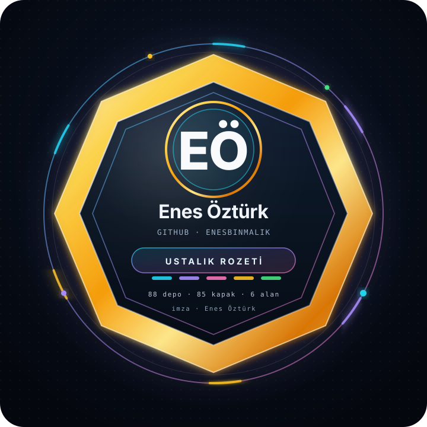

# Enes Öztürk

**Bilgisayar Programcılığı Öğrencisi · IoT & Yazılım Geliştirici · AI & Cloud Meraklısı**

---

## ⭐ Öne Çıkanlar

Teknik derinlik, veri akışı ve mimari açısından en çok gurur duyduğum beş proje

<table>
<tr>
<td align="center" width="33%">
 
<b>Kripto Takip</b> 
Canlı fiyat · sparkline · portföy
</td>
<td align="center" width="33%">
 
<b>Realtime Chat</b> 
Socket.io · odalı · eşzamanlı
</td>
<td align="center" width="33%">
 
<b>Router Sınıfı</b> 
Regex rota · dispatcher · testler
</td>
</tr>
<tr>
<td align="center" width="33%">
 
<b>Kitap Arama</b> 
Google Books · künye · favoriler
</td>
<td align="center" width="33%">
 
<b>Atelier</b> 
Lüks vitrin · filtre · sepet
</td>
<td align="center" width="33%">
<a href="https://github.com/EnesBinMalik/Kodluyoruz---lk-GitHub-Depom-dev-1-">+ 10 proje daha Kodluyoruz arşivinde →</a>
</td>
</tr>
</table>

---

## Göz Bebeği Projelerim

<table>
<tr>
<td align="center" width="50%">
 
<b>The Architect's Core</b> 
Birinci şahıs siber-mühendislik · JIT derleme · 3D nano-dünya 
<a href="https://github.com/EnesBinMalik/the-architect-s-core">kaynak</a>
</td>
<td align="center" width="50%">
 
<b>Neural Architect: The Bio-Synthetic Abyss</b> 
Navier-Stokes akışkan simülasyonu · sinaptik ağ kurgulama 
<a href="https://github.com/EnesBinMalik/neural-architect-the-bio-synthetic-abyss">kaynak</a>
</td>
</tr>
<tr>
<td align="center" width="50%">
 
<b>ENES ENGINE: ARCHITECT 0x00</b> 
Kendi oyun motorum · x86-64/ARM donanım hackleme 
<a href="https://github.com/EnesBinMalik/enes-engine-architect-0x00">kaynak</a>
</td>
<td align="center" width="50%">
 
<b>The Last Component (Son Bileşen)</b> 
Atmosferik 3D keşif · fizik tabanlı makro-mekanik macera 
<a href="https://github.com/EnesBinMalik/the-last-component-son-bilesen">kaynak</a>
</td>
</tr>
</table>

Dördü de <b>MIT Lisansı</b> ile yayınlandı · © 2026 Enes Öztürk — tüm hakları saklıdır

---

## 📚 Tamamlanan Ödevler

87 ödev · her biri imzalı kapak, rozet ve README ile · Frontend 101'den Java'ya, UML'den C#'a

**Frontend** · 30 ödev

<table><tr><td align="center" width="25%"></td><td align="center" width="25%"></td><td align="center" width="25%"></td><td align="center" width="25%"></td></tr></table>
<table><tr><td align="center" width="25%"></td><td align="center" width="25%"></td><td align="center" width="25%"></td><td align="center" width="25%"></td></tr></table>
<table><tr><td align="center" width="25%"></td><td align="center" width="25%"></td><td align="center" width="25%"></td><td align="center" width="25%"></td></tr></table>
<table><tr><td align="center" width="25%"></td><td align="center" width="25%"></td><td align="center" width="25%"></td><td align="center" width="25%"></td></tr></table>
<table><tr><td align="center" width="25%"></td><td align="center" width="25%"></td><td align="center" width="25%"></td><td align="center" width="25%"></td></tr></table>
<table><tr><td align="center" width="25%"></td><td align="center" width="25%"></td><td align="center" width="25%"></td><td align="center" width="25%"></td></tr></table>
<table><tr><td align="center" width="25%"></td><td align="center" width="25%"></td><td align="center" width="25%"></td><td align="center" width="25%"></td></tr></table>
<table><tr><td align="center" width="25%"></td><td align="center" width="25%"></td><td width="25%"></td><td width="25%"></td></tr></table>

**Java** · 45 ödev

<table><tr><td align="center" width="25%"></td><td align="center" width="25%"></td><td align="center" width="25%"></td><td align="center" width="25%"></td></tr></table>
<table><tr><td align="center" width="25%"></td><td align="center" width="25%"></td><td align="center" width="25%"></td><td align="center" width="25%"></td></tr></table>
<table><tr><td align="center" width="25%"></td><td align="center" width="25%"></td><td align="center" width="25%"></td><td align="center" width="25%"></td></tr></table>
<table><tr><td align="center" width="25%"></td><td align="center" width="25%"></td><td align="center" width="25%"></td><td align="center" width="25%"></td></tr></table>
<table><tr><td align="center" width="25%"></td><td align="center" width="25%"></td><td align="center" width="25%"></td><td align="center" width="25%"></td></tr></table>
<table><tr><td align="center" width="25%"></td><td align="center" width="25%"></td><td align="center" width="25%"></td><td align="center" width="25%"></td></tr></table>
<table><tr><td align="center" width="25%"></td><td align="center" width="25%"></td><td align="center" width="25%"></td><td align="center" width="25%"></td></tr></table>
<table><tr><td align="center" width="25%"></td><td align="center" width="25%"></td><td align="center" width="25%"></td><td align="center" width="25%"></td></tr></table>
<table><tr><td align="center" width="25%"></td><td align="center" width="25%"></td><td align="center" width="25%"></td><td align="center" width="25%"></td></tr></table>
<table><tr><td align="center" width="25%"></td><td align="center" width="25%"></td><td align="center" width="25%"></td><td align="center" width="25%"></td></tr></table>
<table><tr><td align="center" width="25%"></td><td align="center" width="25%"></td><td align="center" width="25%"></td><td align="center" width="25%"></td></tr></table>
<table><tr><td align="center" width="25%"></td><td width="25%"></td><td width="25%"></td><td width="25%"></td></tr></table>

**HTML & CSS** · 7 ödev

<table><tr><td align="center" width="25%"></td><td align="center" width="25%"></td><td align="center" width="25%"></td><td align="center" width="25%"></td></tr></table>
<table><tr><td align="center" width="25%"></td><td align="center" width="25%"></td><td align="center" width="25%"></td><td width="25%"></td></tr></table>

**UML & Mimarî** · 4 ödev

<table><tr><td align="center" width="25%"></td><td align="center" width="25%"></td><td align="center" width="25%"></td><td align="center" width="25%"></td></tr></table>

**C#** · 1 ödev

<table><tr><td align="center" width="25%"></td><td width="25%"></td><td width="25%"></td><td width="25%"></td></tr></table>

---

## 🏅 Rozet Vitrini

Quickdraw · Pull Shark · Pair Extraordinaire · Galaxy Brain · YOLO — hepsi gerçek katkılarla kazanıldı

---

## 🏅 Başarılar

Bunlar sözle değil, depoyla kazanıldı: 2026 Nisan'da ilk satır kodla başladım, bugün 126 public depo ve
85 projeye imza kapağı çıkardım. Aşağıdaki tablo o yolun durakları — kalkan ve altıgen de o yolun imzası.

<table>
<tr>
<td width="45%"></td>
<td width="55%" valign="top">

| # | Başarı | Ne zaman |
|:-:|---|---|
| 🚀 | **İlk uçuş** — ilk depo yayında (`Kodluyoruz — İlk GitHub Depom`) | Eki 2026 |
| 📦 | **Arşivci** — 126 public depo tek hesapta | 2026 |
| 🎨 | **İmza kapağı** — 85 projeye elle üretilmiş premium kapak | Kas 2026 |
| 🧱 | **Kurumsal mimari** — 8 proje: katmanlı mimari, OOP, SOLID, UML/EER | Kas 2026 |
| ⚡ | **Yığın ustası** — TypeScript · React · Node · GraphQL · Java · Rust · Solana · .NET | 2026 |
| 🧪 | **Test yazarı** — React Testing Library & birim test koşucusu | Kas 2026 |
| 🔐 | **Güvenlik odaklı** — rol bazlı yetki, 3 hatalı giriş kilidi, JWT | Kas 2026 |
| 📊 | **Veri analitiği** — RFM segmentasyonu, satış & kredi riski tahmini | Kas 2026 |
| 🌍 | **Topluluk** — 47 takipçi, 50 takip | 2026 |

</td>
</tr>
</table>

### 🎯 Uzmanlık alanları

Yaptığım iş, tek tek ödevler değil; birbirini besleyen altı alan. Her alanın altında o alanda çıkan somut iş var.

<table>
<tr><td width="33%" valign="top">

**Kurumsal mimari**
Katmanlı mimari, S.O.L.I.D, tasarım desenleri, UML/EER.
`kariyerportalı` · `hrms` · `öztürk-bank-atm` · `movie-store-webapi`

</td><td width="33%" valign="top">

**Veri & tahmin**
RFM segmentasyonu, satış tahmini, kredi risk skoru, ML capstone.
`e-ticaret-segmentasyon` · `kredi-risk` · `enerji-talebi-ml`

</td><td width="33%" valign="top">

**Gerçek zamanlı & API**
GraphQL şema/resolver, subscription, Redis PubSub, REST + JWT.
`anonymous-chat` · `realtime-voting` · `countries-graphql`

</td></tr>
<tr><td valign="top">

**Web3 & akıllı sözleşme**
Solana program (Rust), PDA, Borsh, dApp ön yüzü.
`solana-restaurant-review` · `solana-token-transfer` · `aptos-vault`

</td><td valign="top">

**Java & Rust çekirdeği**
OOP, generics, Stream API, ownership, trait, Result.
`java-mylist` · `macera-oyunu` · `rust-sahiplik` · `quick-sort-java`

</td><td valign="top">

**Arayüz & ürün**
React + TypeScript, Context/Redux, erişilebilir ve ölçekli arayüz.
`patika-klonu` · `hafıza-oyunu` · `markdown-previewer`

</td></tr>
</table>

### 📈 Bu yılın çizgisi

| Dönem | Ne oldu |
|---|---|
| **Nis 2026** | Hesap açıldı, ilk depo: `Kodluyoruz — İlk GitHub Depom` |
| **Eki 2026** | Java ve web ödev serisi — 60+ depo tek tek yayınlandı |
| **Kas 2026** | Proje arşivi birleştirildi: 85 proje, hepsine imza kapağı ve README |
| **Kas 2026** | Kurumsal mimari serisi: kariyer portalı, HRMS, ATM, WebAPI, kredi riski |

---

## 🧭 Ne üzerinde çalışıyorum

- **85 projelik arşiv** — [patika-dev-odevler](https://github.com/EnesBinMalik/patika-dev-odevler): Node.js, GraphQL,
  Express/MongoDB, Java, Rust, Solana, React, veri analitiği ve kurumsal mimari projeleri; her biri kendi imza kapağı ve README'siyle.
- **Kurumsal mimari serisi** — katmanlı mimari, S.O.L.I.D, tasarım desenleri, UML/EER diyagramları.
- **Veri & tahmin** — müşteri segmentasyonu (RFM), satış tahmini, kredi risk skoru.
- **IoT & Cloud** — sensör verisi toplama ve bulut tarafında işleme üzerine denemeler.

## 🛠️ Yığın

## 📊 Rakamlarla

| Ölçü | Değer |
|---|---|
| Public depo | **126** |
| Proje arşivi | **85 proje** · 85 imzalı kapak · 85 README |
| Arşiv commit'i | 7 (2026-11-07 → bugün) |
| Teknoloji hattı | 8 hat · TypeScript, React, Node, GraphQL, Java, Rust, Solana, .NET |
| Takipçi / takip | 47 / 50 |

## 📫 İletişim

- LinkedIn: [enes-öztürk](https://www.linkedin.com/in/enes-%C3%B6zt%C3%BCrk-53a75a3a8)
- E-posta: enesbino38@gmail.com
- Arşiv: [patika-dev-odevler](https://github.com/EnesBinMalik/patika-dev-odevler)

<b>Enes Öztürk</b> · bu profil ve tüm kapaklar kendi imza dilimle üretildi

