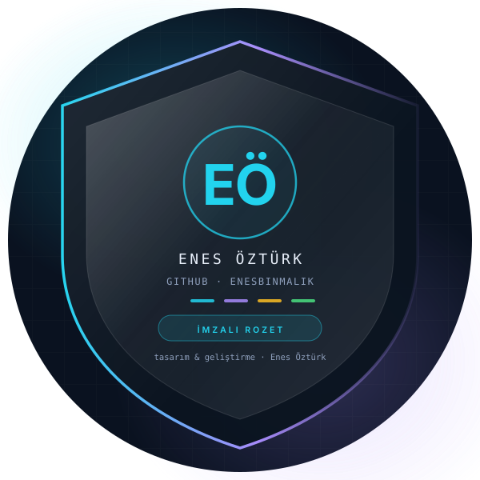
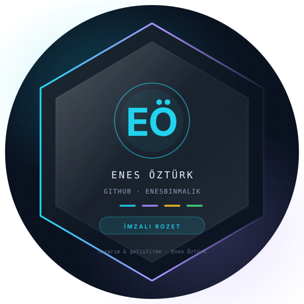

# Enes Öztürk

**Bilgisayar Programcılığı Öğrencisi · IoT & Yazılım Geliştirici · AI & Cloud Meraklısı**

---

## 🏅 Başarılar

Her rozet, tamamlanmış bir işin karşılığı. Sağdaki kalkan ve altıgen, profilin imza rozeti — istenen rozet görselini
`Settings → Profile → Achievements` vitrinine ekleyebilirsin.

<table>
<tr>
<td width="45%"></td>
<td width="55%" valign="top">

| # | Başarı | Ne zaman |
|:-:|---|---|
| 🚀 | **İlk uçuş** — ilk depo yayında (`Kodluyoruz — İlk GitHub Depom`) | Eki 2026 |
| 📦 | **Arşivci** — 126 public depo tek hesapta | 2026 |
| 🎨 | **İmza kapağı** — 85 projeye elle üretilmiş premium kapak | Kas 2026 |
| 🧱 | **Kurumsal mimari** — 8 proje: katmanlı mimari, OOP, SOLID, UML/EER | Kas 2026 |
| ⚡ | **Yığın ustası** — TypeScript · React · Node · GraphQL · Java · Rust · Solana · .NET | 2026 |
| 🧪 | **Test yazarı** — React Testing Library & birim test koşucusu | Kas 2026 |
| 🔐 | **Güvenlik odaklı** — rol bazlı yetki, 3 hatalı giriş kilidi, JWT | Kas 2026 |
| 📊 | **Veri analitiği** — RFM segmentasyonu, satış & kredi riski tahmini | Kas 2026 |
| 🌍 | **Topluluk** — 47 takipçi, 50 takip | 2026 |

</td>
</tr>
</table>

### 🥇 GitHub Achievements

GitHub'ın kendi rozetleri de burada — profilde **Settings → Profile** altından görünür.
Kalan üç rozeti açmak için aşağıdaki "kazanılan yol" bölümüne bak.

| Rozet | Durum | Nasıl kazanılır |
|---|:-:|---|
| **Pull Shark** | 🦈 | Bir pull request'i merge ettirmek |
| **Pair Extraordinaire** | 👥 | Bir başkasıyla ortak yazarlı (co-authored) commit |
| **YOLO** | 🤠 | Bir pull request'i incelemeden merge etmek |
| **Quickdraw** | ⚡ | Bir issue veya PR'ı açtıktan sonra 5 dakika içinde kapatmak |
| **Public Sponsor** | 💖 | GitHub Sponsors üzerinden bir projeye sponsor olmak |
| **Galaxy Brain** | 🧠 | Topluluk tartışmasında kabul edilen yanıt vermek |
| **Starstruck** | ⭐ | 16+ yıldız alan bir depo yayınlamak |

---

## 🧭 Ne üzerinde çalışıyorum

- **85 projelik arşiv** — [patika-dev-odevler](https://github.com/EnesBinMalik/patika-dev-odevler): Node.js, GraphQL,
  Express/MongoDB, Java, Rust, Solana, React, veri analitiği ve kurumsal mimari projeleri; her biri kendi imza kapağı ve README'siyle.
- **Kurumsal mimari serisi** — katmanlı mimari, S.O.L.I.D, tasarım desenleri, UML/EER diyagramları.
- **Veri & tahmin** — müşteri segmentasyonu (RFM), satış tahmini, kredi risk skoru.
- **IoT & Cloud** — sensör verisi toplama ve bulut tarafında işleme üzerine denemeler.

## 🛠️ Yığın

## 📊 Rakamlarla

| Ölçü | Değer |
|---|---|
| Public depo | **126** |
| Proje arşivi | **85 proje** · 85 imzalı kapak · 85 README |
| Arşiv commit'i | 7 (2026-11-07 → bugün) |
| Teknoloji hattı | 8 hat · TypeScript, React, Node, GraphQL, Java, Rust, Solana, .NET |
| Takipçi / takip | 47 / 50 |

## 📫 İletişim

- LinkedIn: [enes-öztürk](https://www.linkedin.com/in/enes-%C3%B6zt%C3%BCrk-53a75a3a8)
- E-posta: enesbino38@gmail.com
- Arşiv: [patika-dev-odevler](https://github.com/EnesBinMalik/patika-dev-odevler)

<b>Enes Öztürk</b> · bu profil ve tüm kapaklar kendi imza dilimle üretildi

